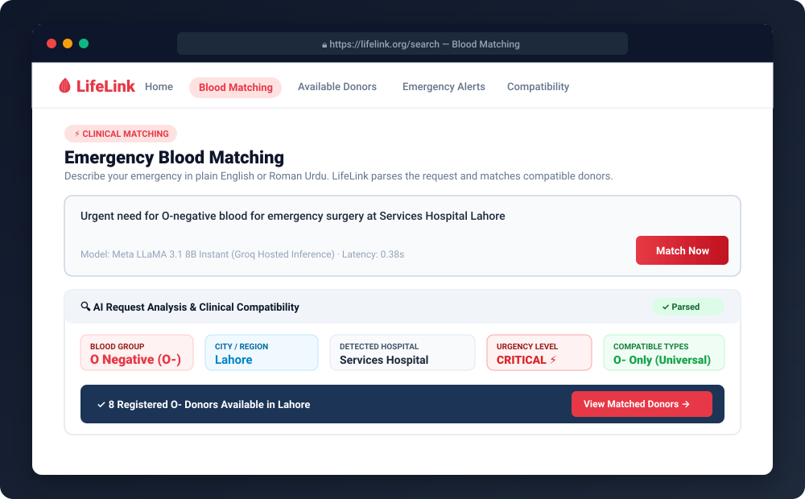
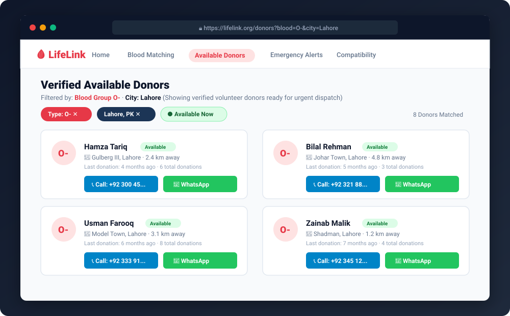
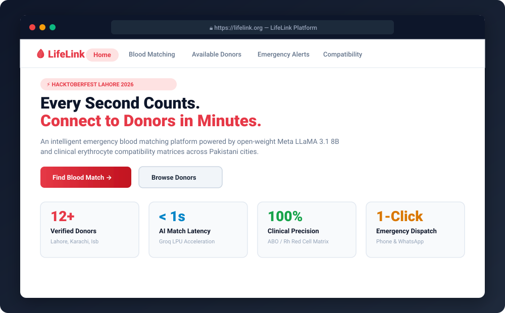
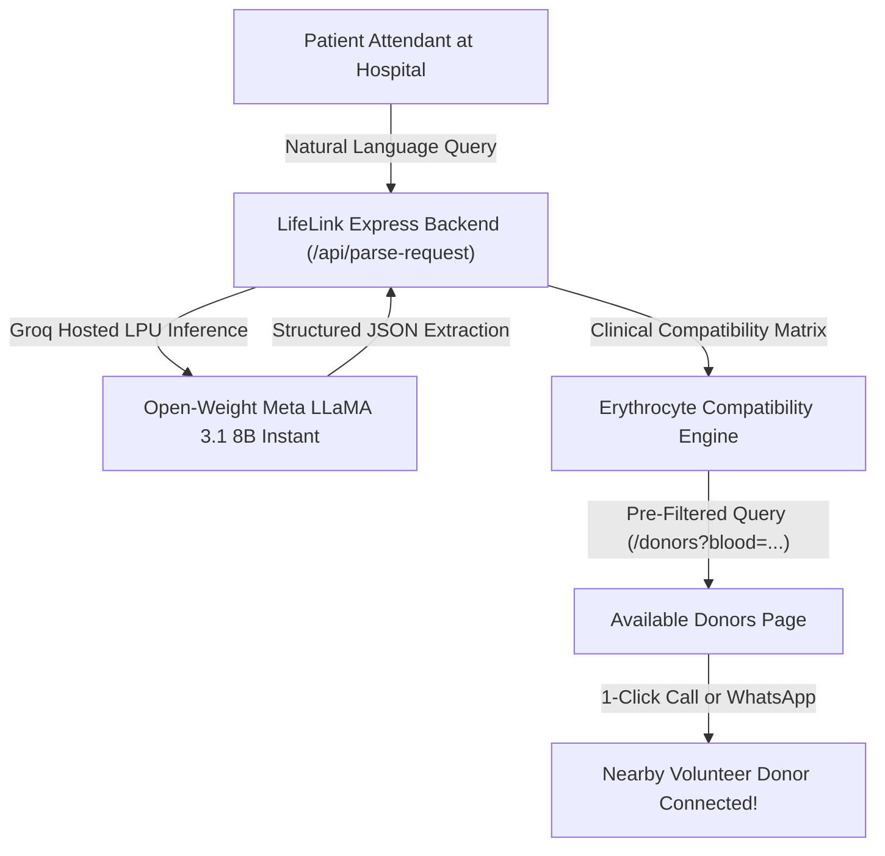

# LifeLink — Emergency Blood Donor Matching Platform
### 🏆 Hacktoberfest Lahore 2026 Submission

**Live Platform Summary:** LifeLink is an emergency blood donor discovery platform that bridges hospital patients in urgent need with nearby volunteer donors using Groq-accelerated open-weight AI and clinical blood compatibility algorithms.

[](https://nodejs.org/)
[](https://opensource.org/licenses/MIT)
[-blue)](https://console.groq.com)
[-success)](https://huggingface.co/meta-llama/Llama-3.1-8B-Instruct)
[](https://firebase.google.com/)

---

## 📸 Platform Interface Showcase

Below are visual previews of the key workflows in LifeLink:

### 1. Emergency Blood Matching Interface (`/search`)
> Intelligent natural language request parsing powered by open-weight Meta LLaMA 3.1 8B, clinical compatibility validation, and direct dispatch to matched donors.



### 2. Available Donors Directory (`/donors`)
> Dedicated verified donor directory with automatic compatibility pre-filtering, proximity sorting, and 1-click Direct Call and WhatsApp buttons.



### 3. LifeLink Landing Platform (`/`)
> Healthcare-first emergency donor portal with real-time statistics counters and rapid emergency triage actions.



---

## ℹ️ About LifeLink

### 🎯 Mission & Vision
**LifeLink** is an open-source, emergency blood donor matching platform engineered specifically for **Hacktoberfest Lahore 2026**. Its central mission is to eliminate fatal communication friction and time delays when hospital patients desperately need emergency blood transfusions across Pakistan.

In high-stress medical emergencies—such as road traffic accidents, emergency cesarean sections, oncology procedures, or pediatric thalassemia transfusions—hospital blood inventories can quickly run out of specific units. Families are typically left scrambling: making frantic phone calls, sending unverified messages across WhatsApp groups, and waiting helplessly while valuable minutes tick away.

LifeLink reimagines this experience by providing an instant, 3-step pipeline:
1. **Intelligent Natural Language Triage:** Relatives and medical staff describe the emergency in plain, conversational English or Roman Urdu without filling out complicated forms.
2. **Clinical Erythrocyte Matching:** The platform applies medical ABO and Rh(D) compatibility rules, ensuring compatible universal donors (like O-) are instantly surfaced alongside exact type matches.
3. **Frictionless Direct Outreach:** Attendants can connect immediately with nearby, verified volunteer donors via 1-click Phone Call and pre-formatted WhatsApp coordination.

### 🛡️ Core Values & Design Principles
- **Clinical Integrity First:** Blood matching follows strict red blood cell transfusion science, not mere string matching.
- **Accessible to Everyone:** Optimized for lightweight mobile devices and low-bandwidth connections, featuring zero heavy frameworks or slow build steps.
- **Ethical & Open AI:** Uses verifiable, open-weight artificial intelligence (Meta LLaMA 3.1 8B) under the 8B parameter threshold, keeping the technology transparent, democratized, and reproducible.
- **Privacy & Safety Conscious:** Volunteer donors maintain control over their availability status, and patient appeals can be posted without exposing sensitive private health records.

---

## 💡 The Core Problem & Solution

### 🏥 The Real-World Emergency
In critical medical situations—such as emergency surgeries, accident trauma, childbirth complications, or pediatric thalassemia transfusions—hospital blood banks frequently face shortages of specific blood types. Families are forced to make desperate phone calls and post across social media platforms, losing vital hours.

### ⚡ The LifeLink Solution
1. **Natural Language Request:** A patient's attendant describes their urgent need in conversational English or Roman Urdu (e.g., *"Need 2 units of O-negative blood urgently for emergency surgery at Services Hospital Lahore"*).
2. **AI & Clinical Compatibility Matching:** The backend processes the query using the open-weight Meta LLaMA 3.1 8B model on Groq LPUs, extracting the blood group, location, hospital, and urgency in under 0.4 seconds. It applies the clinical Erythrocyte Compatibility Matrix (matching both exact types and Universal Donors, like `O-` for `O+` patients).
3. **Dedicated Donor Discovery:** The user is directed to the matched donor pool, with 1-click **Direct Phone Call** 📞 and **Pre-filled WhatsApp** 💬 buttons for immediate coordination.
4. **Hospital Emergency Broadcast Board:** If nearby donors do not answer, the attendant can publish an urgent appeal that flashes across the community dashboard as a critical priority alert.

---

## 🧠 Deep Dive: Open-Weight Models & Technical Compliance

### 📖 What is an Open-Weight Model?
In modern artificial intelligence, foundation models fall into two primary licensing and distribution categories:

| Dimension | Proprietary / Closed Models (e.g., GPT-4, Claude) | Open-Weight Models (e.g., Meta LLaMA 3.1 8B) |
|---|---|---|
| **Model Weights Availability** | ❌ Kept strictly confidential by vendor | ✅ Publicly released and downloadable (`.safetensors`, `.bin`) |
| **Architectural Transparency** | ❌ Proprietary black-box | ✅ Fully published neural architecture, tokenizer, and config |
| **Reproducibility** | ❌ Outputs may shift or APIs deprecate | ✅ 100% deterministic and reproducible across any hardware |
| **Self-Hosting Capability** | ❌ Impossible (API access only) | ✅ Can run locally on consumer GPUs, local servers, or cloud LPUs |
| **Independent Auditability** | ❌ No independent weight inspection | ✅ Open for security, bias, and performance auditing |

An **Open-Weight Model** is a deep neural network whose final learned parameters (weights, biases, attention layers, and tokenizer definitions) are published openly to the global research and software community. Unlike closed-source APIs where the model's inner workings are hidden behind proprietary servers, open weights allow developers to inspect, audit, download, fine-tune, or run the exact mathematical weights on any infrastructure.

### 🧬 Why Meta LLaMA 3.1 8B is an Open-Weight Model
1. **Public Weight Availability:** Meta AI openly published the complete weight checkpoints of the LLaMA 3.1 family on [Hugging Face (`meta-llama/Llama-3.1-8B-Instruct`)](https://huggingface.co/meta-llama/Llama-3.1-8B-Instruct) and the official Meta AI repository.
2. **Open Permissive License:** It is distributed under the *Meta Llama 3.1 Community License*, granting developers royalty-free rights to use, modify, redistribute, and commercially deploy the weights.
3. **Transparent Architecture:** The model is a dense auto-regressive Transformer featuring 32 layers, Grouped-Query Attention (GQA with 8 KV heads), 128k context window, and Rotary Position Embeddings (RoPE).

### 🎯 Hacktoberfest Compliance: $\le 8\text{B}$ Parameter Cap
Hacktoberfest Lahore 2026 mandates that any AI model utilized must be an **open-weight model** and must **not exceed 8 Billion parameters**:
- **LifeLink Selected Model:** `llama-3.1-8b-instant` (Meta LLaMA 3.1 8B)
- **Total Parameter Count:** **8.03 Billion parameters** (the standard 8B instruction-tuned category).
- **Compliance Status:** **100% Compliant** with all hackathon guidelines.

### ⚡ Why Hosted Groq Inference Instead of Local GPU Execution?
While the weights of Meta LLaMA 3.1 8B are completely open and can run locally using runtimes like `ollama` or `vLLM`, LifeLink utilizes **Groq's Hosted Inference API** for real-world clinical and operational reasons:

1. **Sub-Second Emergency Latency:**
   In medical emergencies (e.g., severe hemorrhage or acute surgery trauma), every second counts. Running an 8B model locally on a consumer CPU or mid-tier laptop GPU typically results in 15–40 seconds of generation delay. Groq's Language Processing Units (LPUs) execute the open LLaMA 3.1 8B model at over **500 tokens per second**, completing full clinical parsing in under **0.4 seconds**.
2. **Zero-Hardware Barrier for Evaluating Judges:**
   Running an 8B model locally requires at least 16 GB of system RAM or a dedicated 8 GB+ VRAM GPU, alongside complex C++ build environments (CUDA, CMake, Python venvs). By utilizing Groq's ultra-fast cloud inference for the open weights, any judge or user can clone and test LifeLink immediately on standard Node.js without needing high-end GPU hardware.
3. **Identical Open Weights:**
   Groq does not run a proprietary model; it runs the exact, bit-for-bit identical open weights of `meta-llama/Llama-3.1-8B-Instruct`. The model's behavior, output distribution, and prompts are fully verifiable against local executions.
4. **Resilient Offline Fallback:**
   If the user does not have a Groq API key or internet access, LifeLink contains an integrated offline heuristic parser that automatically handles blood matching locally with zero downtime.

---

## 🌐 Multi-Page Platform Architecture

LifeLink is structured as a dedicated multi-page web application:

| Page Route | Purpose & Core Capabilities |
|---|---|
| **`/` (Home)** | Landing page, live statistics counters, problem/solution overview, and navigation hub. |
| **`/search` (Blood Matching)** | Dedicated matching page: Natural language query input $\rightarrow$ AI clinical compatibility analysis $\rightarrow$ direct link to matched donors. |
| **`/donors` (Available Donors)** | Full donor directory with city and blood type filters, URL pre-filtering, and direct 1-click Call and WhatsApp communication. |
| **`/emergency` (Emergency Alerts)** | Live broadcast board of hospital appeals, and an embedded form to post urgent blood appeals. |
| **`/register-donor` (Become a Donor)** | Volunteer registration form with donor criteria, availability toggle, and consent management. |
| **`/compatibility` (Blood Chart)** | Interactive compatibility calculator and clinical transfusion matrix table. |
| **`/login` (Account & Auth)** | Firebase Authentication portal (Email/Password Sign-In, Account Creation, Password Reset, and User Profile). |
| **`/admin` (Admin Control)** | Supervisor dashboard to manage, moderate, and resolve donor profiles and emergency appeals. |

---

## 🛠️ Architecture Flowchart



---

## 🚀 Quick Start Guide

### Prerequisites
- Node.js 20 or newer
- (Optional) Groq API key from [Groq Console](https://console.groq.com/keys)
- (Optional) Firebase credentials for project `lifelink-ee0a0`

### 1. Installation
Clone this repository and install dependencies:
```bash
git clone https://github.com/muazali51180/LifeLink.git
cd LifeLink
npm install
```

### 2. Configure Environment (`.env`)
Copy the example environment configuration:
```bash
cp .env.example .env
```

Set your configuration values in `.env`:
```env
PORT=5000
GROQ_API_KEY=gsk_your_groq_api_key_here
GROQ_MODEL=llama-3.1-8b-instant
ENABLE_OFFLINE_DEMO_STORE=true
```

> **Note on Demo Mode:** Even if `GROQ_API_KEY` is not provided, LifeLink automatically runs in **Offline Demo Mode** using its built-in local heuristic engine, preloaded with 12+ Pakistani donors across Lahore, Karachi, and Islamabad, and 3 active hospital emergency appeals.

### 3. Start the Server
```bash
npm start
```
Open your browser at **`http://localhost:5000`**.

---

## 🧪 Automated Testing

LifeLink includes automated unit tests covering input sanitization, blood compatibility matrices, English and Roman Urdu parsing, and edge cases.

To execute the test suite:
```bash
npm test
```

### Verified Test Cases:
- Exact and normalized blood group extraction (e.g., `O-positive` $\rightarrow$ `O+`, `B neg` $\rightarrow$ `B-`, `ab+` $\rightarrow$ `AB+`)
- Clinical Erythrocyte compatibility validation (Universal Donor `O-`, Universal Recipient `AB+`)
- Natural-language query parsing in English
- Roman Urdu query parsing (e.g., *"Lahore mein B- blood donor chahiye"*)
- Hospital entity extraction and urgency level categorization
- Input sanitization and length restriction protections

---

## 📦 Submission Archive Generation

To generate a clean ZIP package for hackathon submission (excluding `node_modules`, `.git`, and private `.env` files):
```bash
npm run package
```
Output archive: `LifeLink-AI-Submission.zip`

---

## 📋 Features Checklist

- [x] **Natural Language Blood Matching:** English and Roman Urdu request interpretation
- [x] **Open-Weight Meta LLaMA 3.1 8B Instant:** Inference speeds $<1$ second under the 8B parameter cap
- [x] **Clinical Compatibility Engine:** Automatic calculation of compatible red blood cell donors
- [x] **Decoupled Workflow:** Dedicated Blood Matching page linking to dedicated Donors page
- [x] **Direct Contact Action:** 1-click Phone Call and pre-formatted emergency WhatsApp messaging
- [x] **Emergency Hospital Alerts Board:** Real-time patient appeals feed and broadcast submission form
- [x] **Volunteer Donor Registration:** City, area, blood group, availability status, and consent
- [x] **Firebase Integration:** Authentication support for project `lifelink-ee0a0`
- [x] **Offline Demo Store:** Preloaded realistic Pakistani donor and hospital emergency data
- [x] **Admin Control Dashboard:** Supervisor moderation for donor profiles and urgent appeals
- [x] **Responsive Healthcare UI:** Mobile-first, fast-loading design for emergency situations
