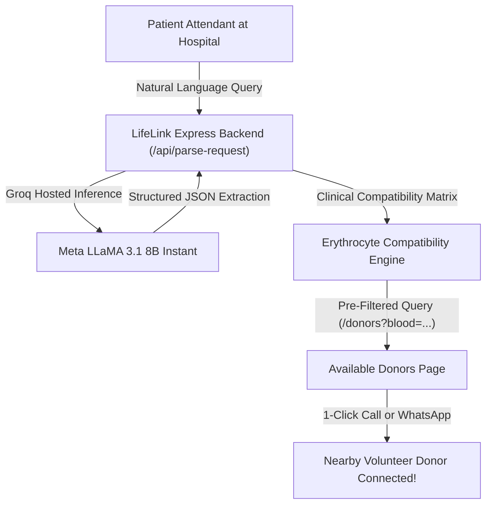

# LifeLink — Emergency Blood Donor Matching Platform
### 🏆 Hacktoberfest Lahore 2026 Submission

**Live Platform Summary:** LifeLink is an emergency blood donor discovery platform that bridges hospital patients in urgent need with nearby volunteer donors using Groq-accelerated AI and clinical blood compatibility algorithms.

[](https://nodejs.org/)
[](https://opensource.org/licenses/MIT)
[](https://console.groq.com)
[](https://firebase.google.com/)

---

## 💡 The Core Problem & Solution

### 🏥 The Real-World Emergency
In critical medical situations—such as emergency surgeries, accident trauma, childbirth complications, or pediatric thalassemia transfusions—hospital blood banks frequently face shortages of specific blood types. Families are forced to make desperate phone calls and post across social media platforms, losing vital hours.

### ⚡ The LifeLink Solution
1. **Natural Language Request:** A patient's attendant describes their urgent need in conversational English or Roman Urdu (e.g., *"Need 2 units of O-positive blood urgently at Services Hospital Lahore"*).
2. **AI & Clinical Compatibility Matching:** The backend processes the query using Meta LLaMA 3.1 8B on Groq, automatically extracting the blood group, location, hospital, and urgency. It applies the clinical Erythrocyte Compatibility Matrix (matching both exact types and Universal Donors, like `O-` for `O+` patients).
3. **Dedicated Donor Discovery:** The user is directed to the matched donor pool, with 1-click **Direct Phone Call** 📞 and **Pre-filled WhatsApp** 💬 buttons for immediate coordination.
4. **Hospital Emergency Broadcast Board:** If nearby donors do not answer, the attendant can publish an urgent appeal that flashes across the community dashboard as a critical priority alert.

---

## 🌐 Multi-Page Platform Architecture

LifeLink is structured as a dedicated multi-page web application:

| Page Route | Purpose & Core Capabilities |
|---|---|
| **`/` (Home)** | Landing page, live statistics counters, problem/solution overview, and navigation hub. |
| **`/search` (Blood Matching)** | Dedicated matching page: Natural language query input $\rightarrow$ AI clinical compatibility analysis $\rightarrow$ direct link to matched donors. |
| **`/donors` (Available Donors)** | Full donor directory with city and blood type filters, URL pre-filtering, and direct 1-click Call and WhatsApp communication. |
| **`/emergency` (Emergency Alerts)** | Live broadcast board of hospital appeals, and an embedded form to post urgent blood appeals. |
| **`/register-donor` (Become a Donor)** | Volunteer registration form with donor criteria, availability toggle, and consent management. |
| **`/compatibility` (Blood Chart)** | Interactive compatibility calculator and clinical transfusion matrix table. |
| **`/login` (Account & Auth)** | Firebase Authentication portal (Email/Password Sign-In, Account Creation, Password Reset, and User Profile). |
| **`/admin` (Admin Control)** | Supervisor dashboard to manage, moderate, and resolve donor profiles and emergency appeals. |

---

## 🤖 AI Model Disclosure (Hackathon Compliance)

- **Provider / Runtime:** Groq Hosted Inference API ([Groq Console](https://console.groq.com/keys))
- **Model ID:** `llama-3.1-8b-instant` (configurable via `GROQ_MODEL`)
- **Parameter Size:** 8.03 Billion parameters (fully complies with the mandatory $\le$ 8B parameter limit)
- **License:** Meta Llama 3.1 Community License (Open-weight)
- **Core Functionality:** Natural language parsing of emergency queries in English and Roman Urdu, entity extraction (blood group, city, hospital name, urgency level).
- **Offline Fallback Engine:** Built-in heuristic NLP parser that automatically activates during offline demonstrations or when API keys are not yet configured, ensuring zero downtime during judging.

---

## 🛠️ Architecture Flowchart



---

## 🚀 Quick Start Guide

### Prerequisites
- Node.js 20 or newer
- (Optional) Groq API key from [Groq Console](https://console.groq.com/keys)
- (Optional) Firebase credentials for project `lifelink-ee0a0`

### 1. Installation
Clone this repository and install dependencies:
```bash
git clone https://github.com/muazali51180/LifeLink.git
cd LifeLink
npm install
```

### 2. Configure Environment (`.env`)
Copy the example environment configuration:
```bash
cp .env.example .env
```

Set your configuration values in `.env`:
```env
PORT=5000
GROQ_API_KEY=gsk_your_groq_api_key_here
GROQ_MODEL=llama-3.1-8b-instant
ENABLE_OFFLINE_DEMO_STORE=true
```

> **Note on Demo Mode:** Even if `GROQ_API_KEY` is not provided, LifeLink automatically runs in **Offline Demo Mode** using its built-in local heuristic engine, preloaded with 12+ Pakistani donors across Lahore, Karachi, and Islamabad, and 3 active hospital emergency appeals.

### 3. Start the Server
```bash
npm start
```
Open your browser at **`http://localhost:5000`**.

---

## 🧪 Automated Testing

LifeLink includes automated unit tests covering input sanitization, blood compatibility matrices, English and Roman Urdu parsing, and edge cases.

To execute the test suite:
```bash
npm test
```

### Verified Test Cases:
- Exact and normalized blood group extraction (e.g., `O-positive` $\rightarrow$ `O+`, `B neg` $\rightarrow$ `B-`, `ab+` $\rightarrow$ `AB+`)
- Clinical Erythrocyte compatibility validation (Universal Donor `O-`, Universal Recipient `AB+`)
- Natural-language query parsing in English
- Roman Urdu query parsing (e.g., *"Lahore mein B- blood donor chahiye"*)
- Hospital entity extraction and urgency level categorization
- Input sanitization and length restriction protections

---

## 📦 Submission Archive Generation

To generate a clean ZIP package for hackathon submission (excluding `node_modules`, `.git`, and private `.env` files):
```bash
npm run package
```
Output archive: `LifeLink-AI-Submission.zip`

---

## 📋 Features Checklist

- [x] **Natural Language Blood Matching:** English and Roman Urdu request interpretation
- [x] **Groq LLaMA 3.1 8B Instant:** Inference speeds $<1$ second under the 8B parameter cap
- [x] **Clinical Compatibility Engine:** Automatic calculation of compatible red blood cell donors
- [x] **Decoupled Workflow:** Dedicated Blood Matching page linking to dedicated Donors page
- [x] **Direct Contact Action:** 1-click Phone Call and pre-formatted emergency WhatsApp messaging
- [x] **Emergency Hospital Alerts Board:** Real-time patient appeals feed and broadcast submission form
- [x] **Volunteer Donor Registration:** City, area, blood group, availability status, and consent
- [x] **Firebase Integration:** Authentication support for project `lifelink-ee0a0`
- [x] **Offline Demo Store:** Preloaded realistic Pakistani donor and hospital emergency data
- [x] **Admin Control Dashboard:** Supervisor moderation for donor profiles and urgent appeals
- [x] **Responsive Healthcare UI:** Mobile-first, fast-loading design for emergency situations
